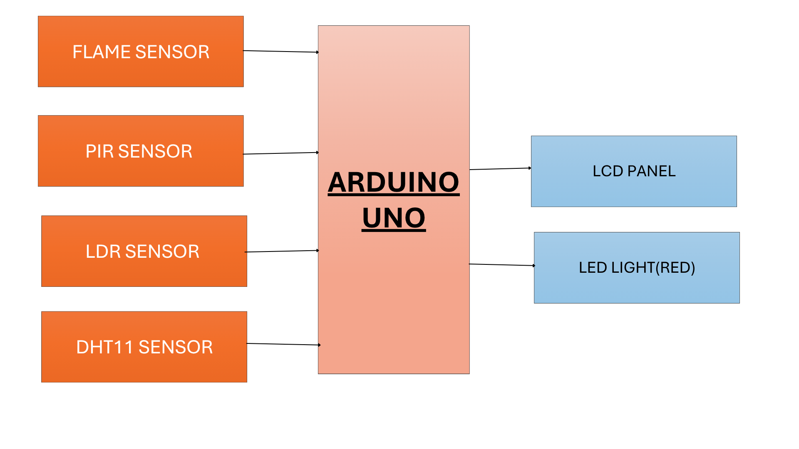
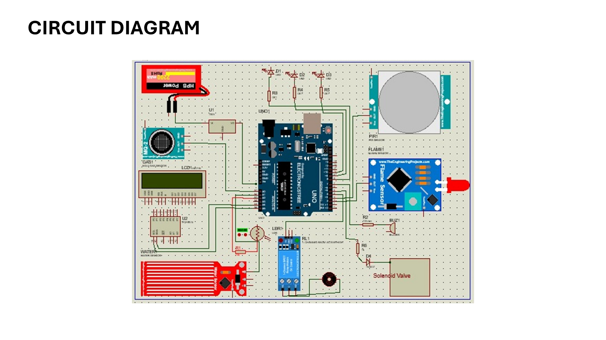

# CATTLEGUARDIAN — Smart Cattle Monitoring System

<p align="center">
  <strong>Arduino Uno | Sensor Integration | Embedded Systems | Farm Automation</strong>
</p>

An Arduino-based monitoring prototype designed to observe environmental conditions and activity around a cattle enclosure using multiple sensors and local alert indicators.

---

## Overview

Livestock environments benefit from continuous monitoring of environmental conditions and unusual activity. Excessive heat, smoke or flame, movement, and water-related conditions may require attention from a farm operator.

CATTLEGUARDIAN combines an Arduino Uno with a collection of sensors and output devices to demonstrate a multi-sensor monitoring system. The proposed design includes environmental sensing, motion detection, visual status indication, an LCD interface, and output control.

## Objectives

- Monitor temperature and humidity using a DHT11 sensor.
- Detect flame-related conditions using a flame sensor.
- Detect movement using a PIR sensor.
- Monitor ambient light using an LDR.
- Include gas and water-related sensing as shown in the circuit diagram.
- Display available system information on an LCD.
- Provide visual and audible alerts.
- Explore relay-controlled output operation for farm automation.

## System Block Diagram



The block diagram identifies the Arduino Uno as the main controller.

**Inputs**
- Flame sensor
- PIR motion sensor
- LDR light sensor
- DHT11 temperature and humidity sensor

**Outputs**
- LCD panel
- Red LED indicator

The circuit diagram also includes additional sensing and output components.

## Circuit Diagram



The illustrated circuit includes:

| Component | Intended role |
|---|---|
| Arduino Uno | Central controller |
| Flame sensor | Detects flame-related sensor activity |
| PIR sensor | Detects movement |
| LDR | Measures relative ambient light |
| DHT11 | Measures temperature and humidity |
| MQ-2 gas sensor | Detects combustible-gas-related changes |
| Water sensor | Detects water presence or wetness |
| LCD panel | Displays system information |
| Red LED | Visual status or warning indicator |
| Buzzer | Audible warning |
| Relay module | Switches a connected load |
| Solenoid valve | Controls fluid flow when appropriately configured |

The final pin assignments, relay behavior, and sensor thresholds must be verified against the physical wiring and firmware.

## Hardware Components

- Arduino Uno
- Flame sensor module
- PIR motion sensor
- LDR sensor and suitable interface circuit
- DHT11 temperature and humidity sensor
- MQ-2 gas sensor module
- Water sensor module
- LCD panel
- Red LED and current-limiting resistor
- Buzzer
- Relay module
- Solenoid valve
- Connecting wires and suitable power supplies

## Software and Tools

- Arduino IDE
- Embedded C/C++ for Arduino
- Arduino Uno GPIO and analog inputs
- DHT sensor library
- LiquidCrystal library, if using a parallel LCD connection
- Proteus or another compatible circuit simulation tool, if used during development

## Working Principle

1. Initialize the Arduino and connected sensors.
2. Read temperature and humidity from the DHT11.
3. Monitor the digital output of the flame and PIR sensors.
4. Read analog values from the LDR and any analog sensor interfaces.
5. Evaluate sensor readings against configured thresholds.
6. Display available readings and status information on the LCD.
7. Activate appropriate visual or audible alerts when configured conditions occur.
8. Control the relay output only according to the validated application logic.
9. Repeat the monitoring cycle.

## Applications

Potential educational and prototype applications include:

- Environmental monitoring in cattle sheds.
- Motion monitoring around livestock enclosures.
- Flame and gas warning demonstrations.
- Water-presence monitoring.
- Farm automation experiments.
- Learning multi-sensor integration with Arduino.

## Limitations

- The supplied diagrams do not establish measured detection accuracy or long-term reliability.
- Sensor readings depend on calibration, placement, and environmental conditions.
- The LDR provides relative light measurements rather than a calibrated lux value without further calibration.
- The MQ-2 module is not a substitute for certified gas-safety equipment.
- The circuit does not establish that every proposed function has been tested on physical hardware.

## Future Improvements

- Add wireless monitoring using an appropriate communication module.
- Log sensor readings with timestamps.
- Add a remote dashboard for farm operators.
- Improve sensor calibration and fault detection.
- Add validated alerts for environmental threshold violations.
- Test relay and solenoid behavior with suitable electrical protection.
- Evaluate reliability under actual farm operating conditions.

## Repository Structure

```text
CATTLEGUARDIAN/
├── README.md
├── src/
│   └── cattleguardian.ino
├── images/
│   ├── block-diagram.png
│   └── circuit-diagram.png
└── docs/
    └── wiring.md
```

The structure above is the intended layout; populate it with the actual project files as they are added.

## Author

**Atharva Jadhav**

Electronics and Telecommunication Engineering

- GitHub: [atharva-446](https://github.com/atharva-446)
- Portfolio: [atharvajadhav.co.in](https://atharvajadhav.co.in)

---

*This project is an educational monitoring prototype and should not replace certified livestock, fire, or gas safety systems.*
